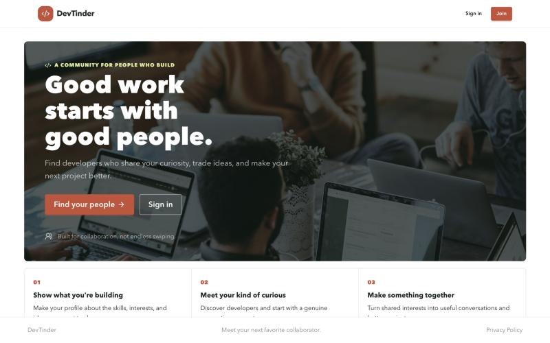
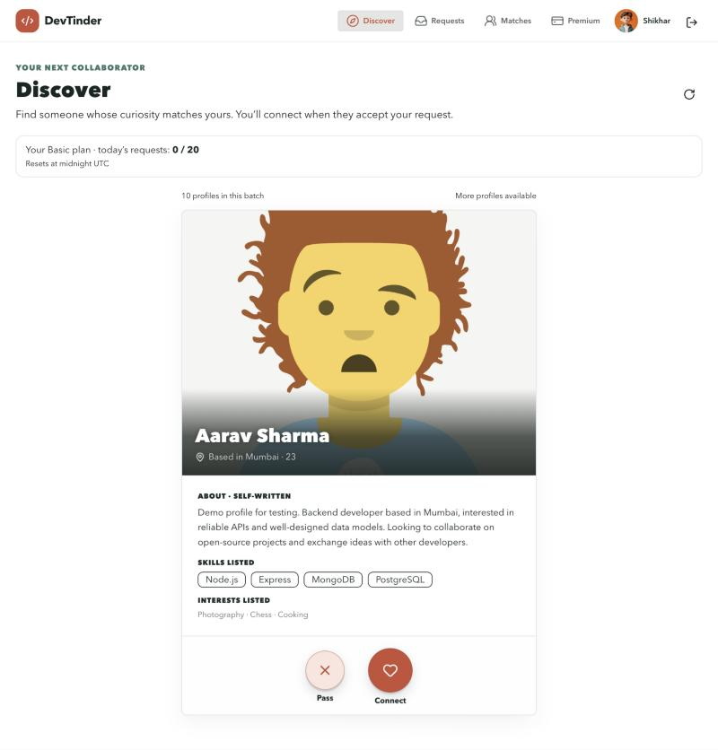
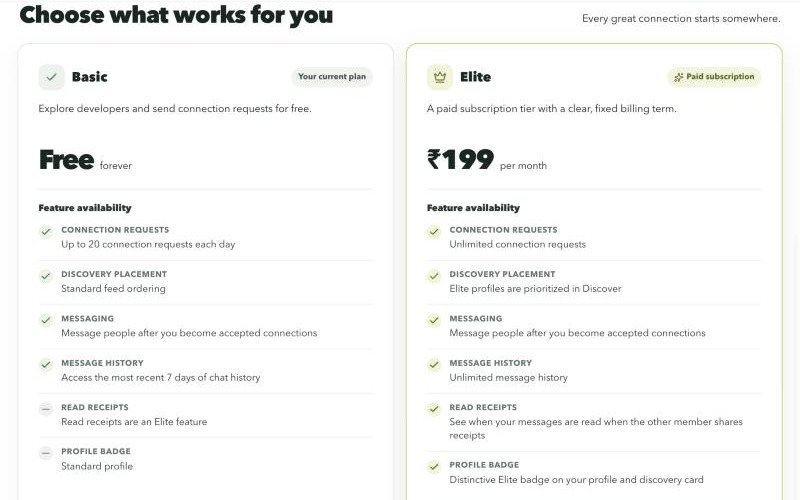
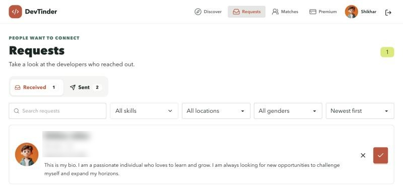
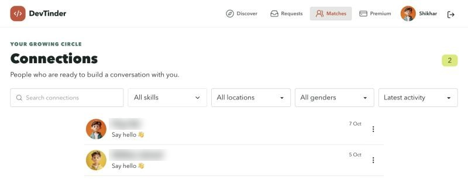
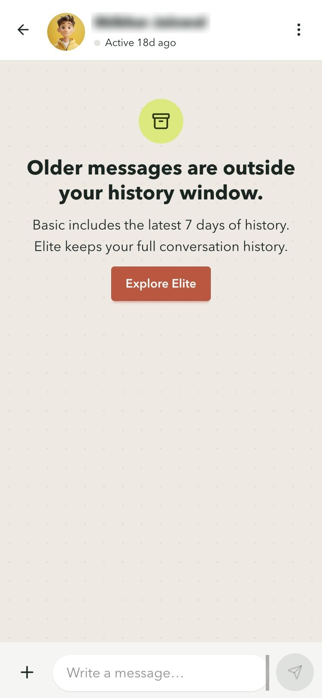
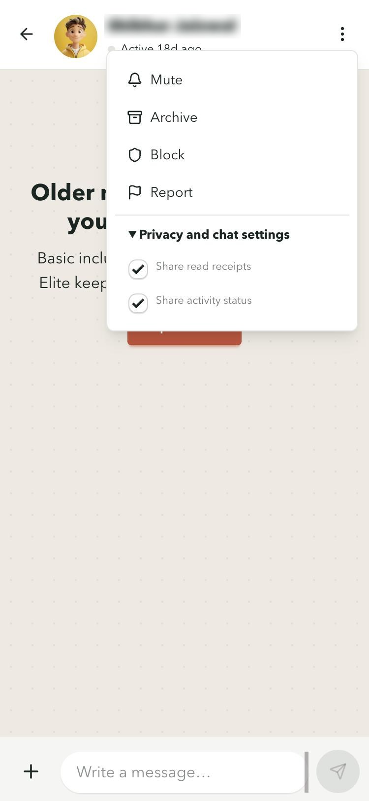
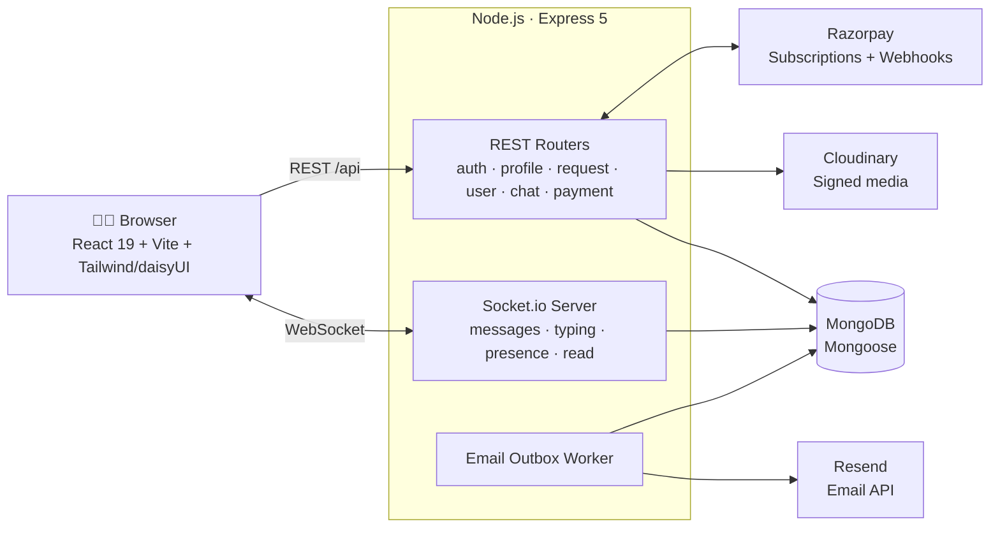

<div align="center">

# 💻❤️ DevTinder

**Find your next collaborator. A matchmaking and real-time chat platform for developers.**

[](https://dev-tinder-community.in/)


### 🌐 Live app: **[dev-tinder-community.in](https://dev-tinder-community.in/)**

<a href="https://dev-tinder-community.in/"></a>

</div>

---

## 📌 Overview

**DevTinder** helps developers meet other developers who want to build things together. Members set up a profile with their skills and interests, browse a discovery feed, send connection requests, and once a request is accepted, chat in real time.

It is a **full-stack MERN application running in production** at **[dev-tinder-community.in](https://dev-tinder-community.in/)**. It includes:

- 🔐 Secure cookie-based JWT authentication
- 🧭 A paginated discovery feed with smart filtering
- 🤝 A connection request workflow with daily quotas
- 💬 A WhatsApp-style real-time chat built on Socket.io (media, reactions, replies, typing, presence, read receipts)
- 💳 A paid **Elite** subscription (₹199/month) through Razorpay, with verified webhooks
- 📧 Transactional emails sent through a fault-tolerant outbox worker (Resend)
- 🛡️ Safety tools: block, report, and per-chat privacy settings

> 🎯 **For recruiters:** this project goes past CRUD. It handles real payments, real-time systems, idempotency, race-condition-safe quotas, SSRF protection, and reliable background jobs, which are problems that come up in production software.

---

## 📸 App Preview

> Screenshots from the live app at [dev-tinder-community.in](https://dev-tinder-community.in/). Other members' names are blurred for privacy.

<table>
  <tr>
    <td width="50%" align="center"><b>🧭 Discover</b><br/><sub>Profile cards with skills and interests, Pass or Connect, and the daily request allowance</sub></td>
    <td width="50%" align="center"><b>💳 Basic vs. Elite plans</b><br/><sub>₹199/month Razorpay subscription with plan-based feature gating</sub></td>
  </tr>
  <tr>
    <td></td>
    <td></td>
  </tr>
  <tr>
    <td align="center"><b>📥 Connection requests</b><br/><sub>Received and sent tabs, search and filters, accept or reject</sub></td>
    <td align="center"><b>🤝 Connections</b><br/><sub>Search, skill, location, and gender filters with activity sorting</sub></td>
  </tr>
  <tr>
    <td></td>
    <td></td>
  </tr>
</table>

<table>
  <tr>
    <td align="center"><b>💬 Chat on mobile</b><br/><sub>Basic plan's 7-day history window, enforced on the server</sub></td>
    <td align="center"><b>🛡️ Chat controls</b><br/><sub>Mute, archive, block, report, and privacy settings</sub></td>
  </tr>
  <tr>
    <td align="center"></td>
    <td align="center"></td>
  </tr>
</table>

---

## ✨ Features

### 👤 Accounts & Profiles
- Sign up, log in, log out, change password, and forgot password flows
- Passwords hashed with **bcrypt**; sessions use a **JWT in an `httpOnly`, `sameSite=strict` cookie** (secure in production)
- Rich developer profiles with photo, bio, age, gender, location, **skills**, and **interests** (tag input)
- Profile-completion tracking that nudges users to fill in their profiles
- Field whitelisting and server-side validation on every write

### 🧭 Discovery Feed
- Paginated feed (`/feed?page=&limit=`, capped at 50 per page) built with a **MongoDB aggregation pipeline**
- Hides your own profile, your existing connections, and anyone you have already acted on
- **Elite members are ranked first** in discovery and carry a distinctive badge
- Search, skill, location, and gender filters with sorting on the Requests and Connections pages

### 🤝 Connections
- Swipe-style actions: **Interested** or **Ignore**
- Incoming and sent request inboxes; **Accept** or **Reject** incoming requests
- Duplicate requests are prevented with a unique **pair key** index, which covers both directions
- **Basic plan: 20 connection requests per day**, enforced with an atomic conditional `findOneAndUpdate` so concurrent requests cannot go over the limit
- Email notifications when a request is received, accepted, or declined

### 💬 Real-Time Chat (Socket.io)
- 1:1 messaging between accepted connections only
- **Typing indicators**, **online presence / last active**, and **delivered and read receipts**
- **Reply to message**, **emoji reactions**, and **delete for me or for everyone**
- **Photo and video attachments** through Cloudinary *authenticated delivery*: media is private and served via signed URLs
- **Link previews** with server-side **SSRF protection** (DNS-level private-IP blocking, timeouts)
- Optimistic UI with client message IDs, so retries never create duplicate messages
- Unread counts, plus **mute** and **archive** per conversation
- Privacy controls: turn **read receipts** and **activity sharing** on or off
- Safety: **block / unblock** users and **report** messages (spam, harassment, and so on)
- Mobile-friendly chat layout that adjusts to the on-screen keyboard (`visualViewport`)

### 💳 Elite Subscription (Razorpay)
| | **Basic** (Free) | **Elite** (₹199 / month) |
|---|---|---|
| Connection requests | 20 per day | **Unlimited** |
| Discovery placement | Standard | **Prioritized** |
| Message history | Last 7 days | **Unlimited** |
| Read receipts | ✗ | ✓ |
| Profile badge | ✗ | **Elite badge** |

- Recurring **Razorpay Subscriptions** with server-side checkout verification
- **HMAC-SHA256 webhook signature verification** using the raw request body
- **Idempotent subscription creation** (UUID idempotency keys) so double-clicks never bill twice
- **Webhook de-duplication** by event ID *and* payload hash
- Subscription lifecycle handled for `activated`, `charged`, `halted`, `cancelled`, and `completed` events. Access is granted only after a confirmed charge.

### 📧 Transactional Email (Resend)
- Branded HTML templates: welcome, connection request / accepted / declined, Elite purchase, renewal, payment attention, and subscription ended
- **Transactional outbox pattern**: emails are written to MongoDB first, then a background worker delivers them with **locking, retries, and exponential backoff** (up to 8 attempts)
- Event keys make every notification **exactly-once** from the user's point of view

---

## 🏗️ Architecture



**Request flow highlights**
- The REST API and Socket.io share **one HTTP server**. Sockets are authenticated with the same JWT cookie.
- Each user joins a private `user:<id>` room for presence and notifications, and each conversation has its own room for messages and typing events.
- The payment webhook route uses `express.raw()` so the signature is checked against the exact bytes Razorpay sent. All other routes use JSON with a 32 KB body limit.

---

## 🛠️ Tech Stack

| Layer | Technologies |
|---|---|
| **Frontend** | React 19, React Router 7, Vite, Tailwind CSS 4, daisyUI 5, Lucide icons, Socket.io client, Oxlint |
| **Backend** | Node.js (ES modules), Express 5, Socket.io 4, Mongoose 9, JWT, bcrypt, validator, date-fns |
| **Database** | MongoDB with compound, unique, and sparse indexes |
| **Integrations** | Razorpay (subscriptions and webhooks), Cloudinary (authenticated media), Resend (email) |
| **Tooling** | Root npm scripts, concurrently, nodemon |

---

## 📂 Project Structure

```
dev-tinder/
├── backend/
│   ├── src/
│   │   ├── app.js              # Express + Socket.io bootstrap
│   │   ├── config/             # MongoDB connection
│   │   ├── middlewares/        # JWT auth guard
│   │   ├── models/             # User, ConnectionRequest, Conversation, Message,
│   │   │                       # Payment, EmailOutbox, ChatBlock, ChatReport, ...
│   │   ├── routes/             # auth, profile, request, user (feed), chat, payment
│   │   ├── templates/          # Branded HTML email templates
│   │   └── utils/              # socket, razorpay, attachments, linkPreview, emails, validation
│   ├── scripts/                # ensure-chat-indexes.mjs
│   └── .env.example
├── frontend/
│   └── src/
│       ├── pages/              # Home, Feed, Profile, Requests, Connections, ChatRoom, EnrollPremium, ...
│       ├── components/         # Chat UI (MessageList, MessageBubble, Composer, MediaViewer, ...)
│       ├── hooks/              # useChatSocket, useChatMessages, useMediaUpload, ...
│       ├── context/            # AuthContext
│       └── utils/              # API client, route guards, socket client, helpers
├── scripts/wait-for-backend.mjs
└── package.json                # Runs backend + frontend together
```

---

## 🔌 API Reference (summary)

<details>
<summary><b>Click to expand the endpoint list</b></summary>

| Method | Endpoint | Description |
|---|---|---|
| POST | `/signup` | Create an account |
| POST | `/login` · `/logout` | Start or end a session (cookie) |
| PATCH | `/changePassword` | Change password |
| POST | `/forgotPassword` | Reset password |
| GET | `/profile` | Current user's profile |
| PATCH | `/profile/edit` | Update profile |
| GET | `/feed?page=&limit=` | Discovery feed |
| GET | `/request/quota` | Remaining daily requests |
| POST | `/request/send/:status/:toUserId` | `interested` / `ignored` |
| POST | `/request/review/:status/:requestId` | `accepted` / `rejected` |
| GET | `/user/requests` · `/user/requests/sent` | Incoming / sent requests |
| GET | `/user/connections` | Accepted connections |
| GET | `/chat/conversations` | Conversation list |
| GET | `/chat/unread-count` | Total unread messages |
| GET | `/chat/conversations/with/:targetUserId` | Open or create a chat |
| GET / POST | `/chat/conversations/:id/messages` | Fetch history / send a message |
| POST | `/chat/conversations/:id/attachments` | Upload photo or video |
| DELETE | `/chat/conversations/:id/messages/:messageId` | Delete a message |
| PUT | `/chat/conversations/:id/messages/:messageId/reaction` | React to a message |
| POST | `/chat/conversations/:id/read` | Mark as read |
| PATCH | `/chat/conversations/:id/settings` | Mute / archive |
| PATCH | `/chat/preferences` | Read receipts / activity sharing |
| POST / DELETE | `/chat/blocks/:targetUserId` | Block / unblock |
| POST | `/chat/conversations/:id/reports` | Report a message |
| GET | `/chat/link-preview` | Safe URL preview |
| POST | `/payment/create-subscription` | Start Elite checkout |
| POST | `/payment/verify-subscription` | Verify checkout signature |
| GET | `/payment/subscription` | Current subscription status |
| POST | `/payment/webhook` | Razorpay webhook receiver |

**Socket events:** `conversation:join`, `conversation:leave`, `message:send`, `typing:start`, `typing:stop`, `conversation:read`, `presence:update`, `typing:update`

</details>

---

## 🚀 Getting Started

### Prerequisites
- Node.js 20+
- MongoDB (local or Atlas)
- Optional, for the full feature set: Razorpay test account, Cloudinary account, Resend API key

### 1. Clone and install
```bash
git clone https://github.com/shikharskj/dev-tinder.git
cd dev-tinder
npm install
npm install --prefix backend
npm install --prefix frontend
```

### 2. Configure environment
```bash
cp backend/.env.example backend/.env
```
Fill in the values in `backend/.env`:

| Variable | Purpose |
|---|---|
| `PORT` | API port (default `7777`) |
| `FRONTEND_ORIGIN` | Allowed CORS origin, for example `http://localhost:5174` |
| `APP_URL` | Public app URL used in emails |
| `DB_CONNECTION_STRING` | MongoDB connection URI |
| `JWT_SECRET` | Secret for signing auth tokens |
| `RAZORPAY_KEY_ID` / `RAZORPAY_KEY_SECRET` | Razorpay API credentials |
| `RAZORPAY_ELITE_PLAN_ID` | ₹199 monthly plan ID |
| `RAZORPAY_WEBHOOK_SECRET` | Webhook signing secret |
| `CLOUDINARY_CLOUD_NAME` / `_API_KEY` / `_API_SECRET` | Chat media storage |
| `RESEND_API_KEY` / `RESEND_FROM_EMAIL` | Transactional email |

### 3. (Optional) Create chat indexes
```bash
npm --prefix backend run chat:indexes
```

### 4. Run
```bash
npm run dev
```
This starts the **backend** (nodemon, port 7777) and then the **frontend** (Vite) as soon as the API is reachable.

### 🧪 Test payments
Elite checkout runs in Razorpay **test mode**. Use these test details:
- Card: `4718 6091 0820 4366` · Expiry: `12/29` · CVV: `123` · OTP: any 6 digits

---

## 🧠 Engineering Highlights

| Challenge | Solution |
|---|---|
| Users spamming connection requests | Daily quota counter with an **atomic conditional update** (`requestsUsed < 20`) that holds up under concurrency |
| Duplicate A→B / B→A requests | Order-independent **`pairKey`** with a unique sparse index |
| Double billing on retry or double-click | **Idempotency keys** on subscription creation |
| Forged or replayed webhooks | **HMAC signature check on the raw body**, plus de-duplication by event ID and payload hash |
| Emails lost when the provider is down | **Outbox pattern** with worker locking, retries, and exponential backoff |
| SSRF through link previews | Custom DNS `lookup` that rejects private, loopback, and link-local addresses *at connect time* |
| Private media leaking | Cloudinary **authenticated assets** served through short-lived signed URLs |
| Duplicate messages on flaky networks | Client-generated message IDs with a unique index |
| Blocked users still interacting | Access checks on every chat action (accepted connection and not blocked) |
| Basic vs. Elite feature gating | Server-side enforcement: history cutoff, read receipts, quotas, feed ranking |

---

## 🗺️ Roadmap
- [ ] Automated test suite (unit and integration)
- [ ] Group chats / project rooms
- [ ] Skill-based match recommendations
- [ ] Push notifications

---

## 👨‍💻 Author

**Shikhar** · [@shikharskj](https://github.com/shikharskj)

If you like this project, please consider giving it a ⭐. Feedback and opportunities are welcome!

🔗 **Live:** [dev-tinder-community.in](https://dev-tinder-community.in/)
